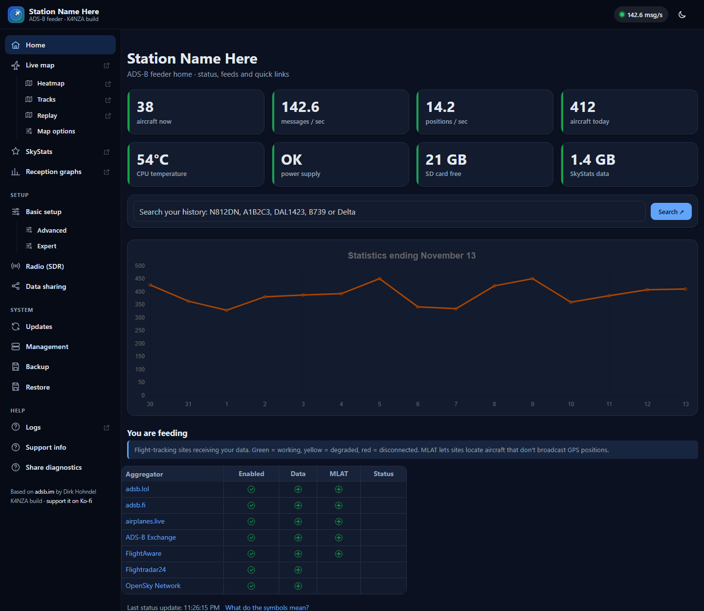
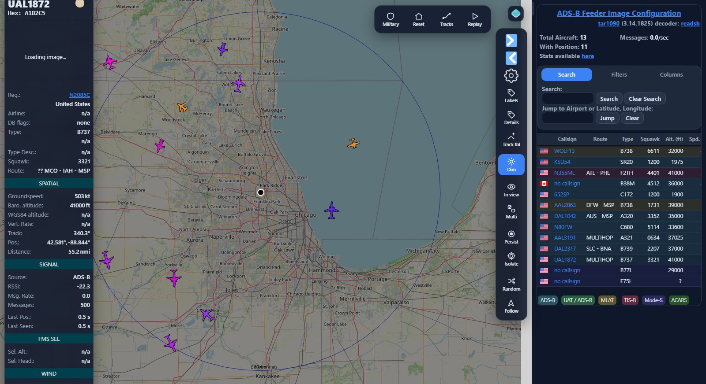
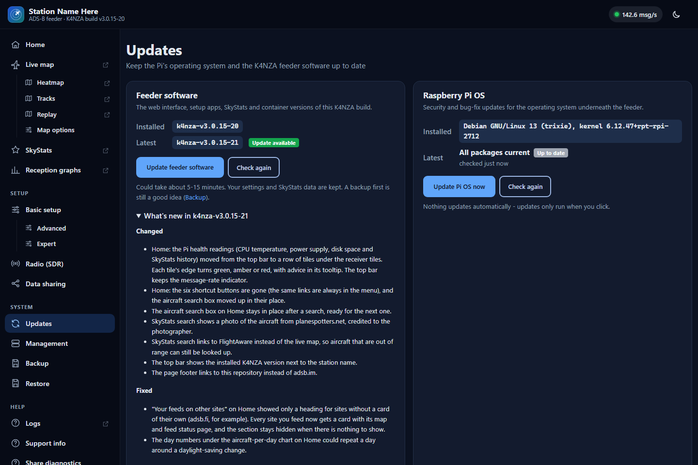
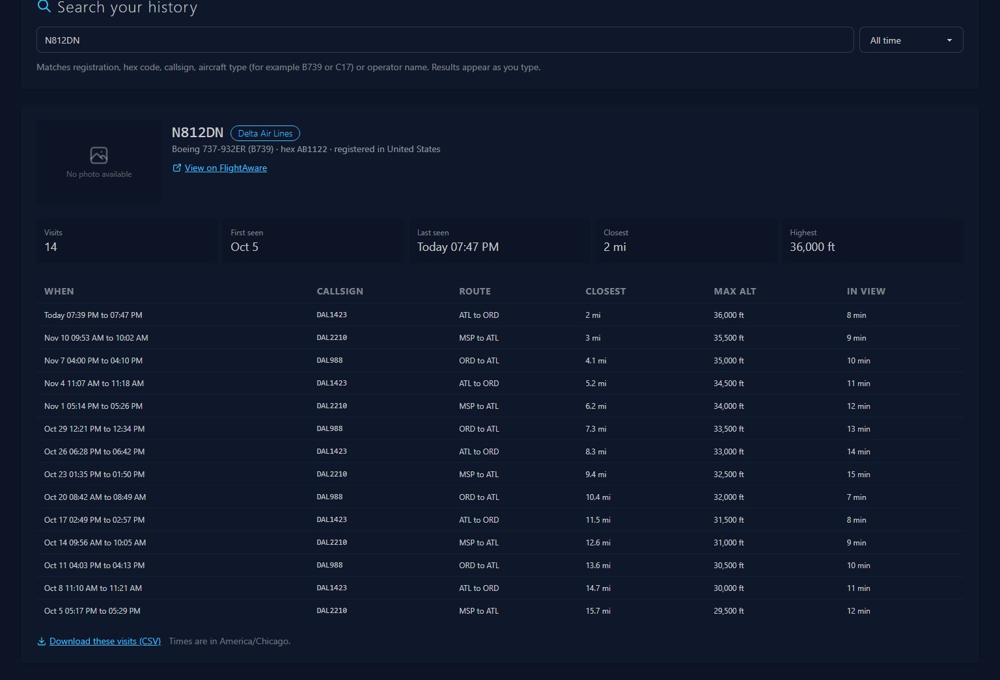
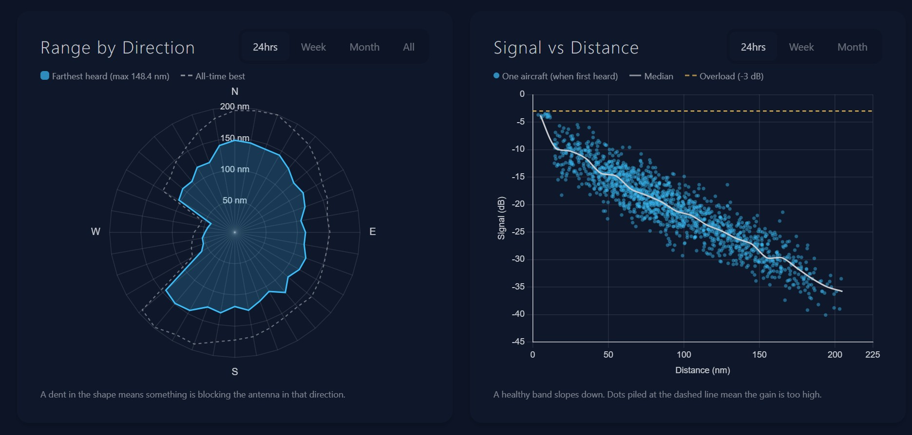
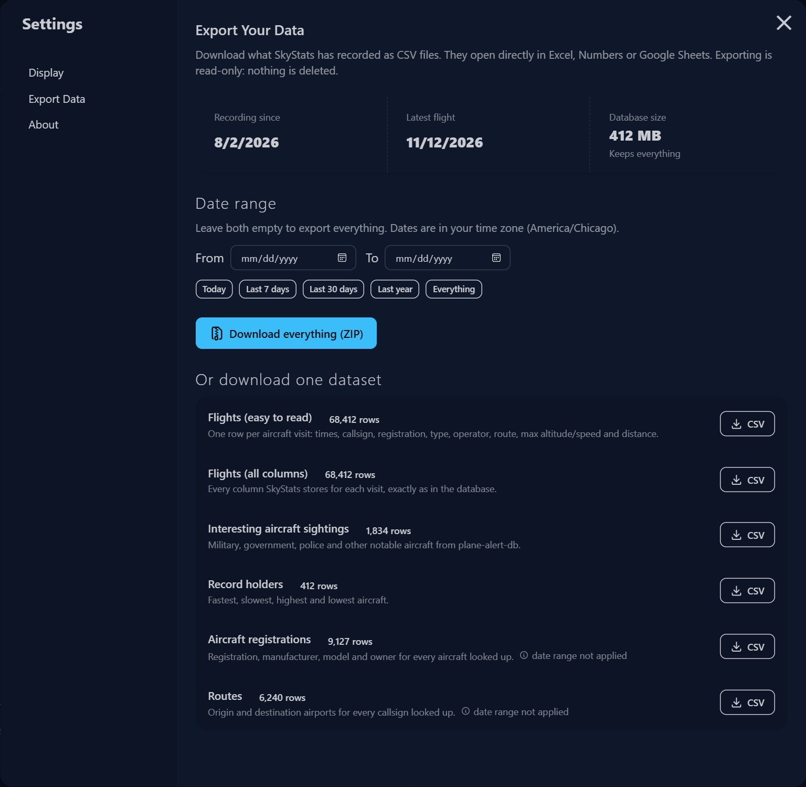
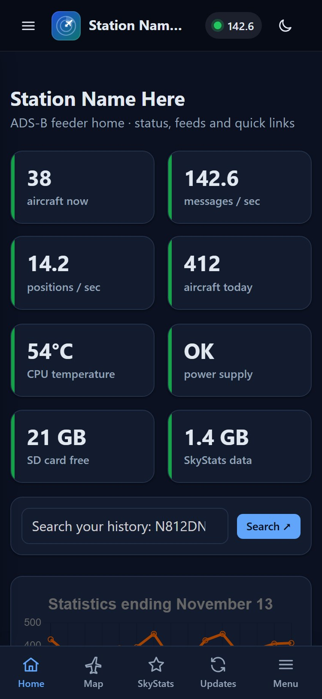

# K4NZA ADS-B Feeder

A customized build of Dirk Hohndel's
[adsb.im ADS-B Feeder Image](https://github.com/dirkhh/adsb-feeder-image) (v3.0.15).
Same feeder underneath, with the differences below. What changed in each release is in the
[CHANGELOG](CHANGELOG.md).

---

## How this build is different

Compared with stock adsb.im v3.0.15:

### Redesigned interface

- Dashboard layout: top bar with live receiver status, sidebar menu (bottom tabs on phones), light/dark mode.
- Home page: status tiles (aircraft now, messages/sec, positions/sec, aircraft today), an aircraft
  search box, full-width aircraft-per-day chart, a one-line update status, and cards for the sites
  you feed. Days run from midnight in the feeder's time zone.
- **Pi health tiles** on Home: CPU temperature, power supply, free SD card space and SkyStats history
  size (and its growth per month). A tile's edge turns amber or red, with advice in its tooltip, when
  something needs attention.
- Plain-English help under every settings section, tooltips on buttons, and confirmation before
  shutdown, reboot and similar actions.
- Radio (SDR) page with a step-by-step guide to better reception.
- *Help → Share diagnostics* downloads anonymized logs and opens a problem report on this GitHub
  repository (stock adsb.im uploads them to public paste sites for its own forums).
- Live map, graphs, SkyStats and logs open in a new tab.

### SkyStats: stable for months, not weeks

- Every request to the decoder and to internet services has a timeout, so one hung request can't
  freeze recording.
- Recording runs separately from the slower background jobs, and every job recovers from errors
  instead of stopping SkyStats.
- Reads the decoder's aircraft list tolerantly: one unexpected value no longer discards the whole list.
- Memory use stays flat: old aircraft are dropped from the in-memory cache.
- A failed plane-alert-db download is retried the next day instead of causing a restart loop.
- The database is tuned for a Pi (enough shared memory, clean shutdown) and tidied weekly.
- Optional history limit: *Setup → Advanced → SkyStats → Keep history (days)* (0 = keep forever).
  All-time numbers (total aircraft and flights, all-time top types, the all-time range outline)
  are kept in small summary tables, so they stay correct when old flights are removed.

### SkyStats: aircraft search

- **Search** tab (or the search box on the feeder's Home page): find an aircraft by registration,
  hex code, callsign, type (for example `B739` or `C17`) or operator, and see every visit: when,
  callsign, route, closest distance, highest altitude and time in view. Download the visits as CSV.
- Shows a photo of the aircraft from planespotters.net (credited to the photographer) and links to
  FlightAware, so aircraft that are out of range can still be looked up.
- SkyStats records how close each aircraft came (also in the Flights export).

### SkyStats: reception charts

- **Range by Direction**: the farthest aircraft heard in each direction around your antenna, with
  your all-time best as an outline. A dent shows where something blocks the antenna.
- **Signal vs Distance**: signal strength against distance, with the median and the overload level,
  for tuning gain and checking antenna or filter changes.
- The Activity tab drops the flight-count charts that duplicated the aircraft charts.
- The Interesting Aircraft tab always shows its four categories (military, government, police,
  civilian) with a short description of what to expect, even before any have been seen.

### SkyStats: export and restore

- **Export** page: download flights, interesting aircraft, records, registrations and routes as CSV
  (opens in Excel or Google Sheets), one at a time or all together in a ZIP, with an optional date range.
- SkyStats backups are streamed and compressed, and can be **restored** (*System → Restore*).

### Gentle on the SD card and CPU

- SkyStats saves aircraft in view at most every 30 seconds (or when a record changes) and reads the
  decoder every 5 seconds, instead of rewriting everything every 2 seconds.
- Small database indexes so background jobs don't scan the whole flight history.
- Container logs are limited to 3 × 10 MB each (Docker's default has no limit).
- The feeder doesn't register with my.adsb.im; it is reached at `http://adsb-feeder.local/` (the
  page footer also shows its IP address).

### Live map

- Modern dark (or light) panels for the buttons, aircraft list, selected-aircraft card, settings and legend.
- The single-letter buttons are now icon-and-word buttons (Labels, Details, Tracks, Follow, Military, ...).
  Keyboard shortcuts are unchanged and shown in each button's tooltip.
- tar1090 itself is unmodified, so it keeps receiving its own updates.

### Units

- **Nautical, Imperial or Metric** for distances, speeds and altitudes in the live map and SkyStats.
  Pick the default for every device under *Live map → Map options*; each browser can still switch on
  its own (map *Settings*, or SkyStats *Settings → Display*).

### Updates

- **Updates** page with one-click feeder and Raspberry Pi OS updates, showing what's installed, what's
  waiting and what's new. No account or key is needed.
- **Go back a version**: after an update, the Updates page offers to reinstall the version the feeder
  ran before (possible from v3.0.15-20 on).
- Updates download only the release being installed, and the SkyStats container is checked against
  a checksum before it is installed.
- Pi OS updates only update packages already installed (like stock adsb.im). If a newer kernel is
  ever installed, the page offers **Restart now**.
- Nothing updates automatically unless you turn on nightly OS updates (*System → Management*).

### Setup

- WiFi can be set before the first boot by editing `k4nza-wifi.txt` on the card from Windows.
- The setup hotspot connects reliably to home WiFi (waits for the network and uses a plain WPA2 profile).
- Image built for Raspberry Pi (64-bit) only, with no maintainer SSH key built in.

## Screenshots

**Home dashboard**: live receiver status, Pi health tiles (CPU temperature, power supply, SD card space,
SkyStats size), aircraft search, aircraft per day and the sites you feed.

**Live map**: modern panels, buttons with words instead of single letters, a tidy aircraft list and
the selected-aircraft card. *(Sample aircraft, shown over Chicago.)*

**One-click updates** for the feeder software and Raspberry Pi OS, showing what's installed, what's
waiting and what's new in the newest release.

**SkyStats aircraft search**: every visit of an aircraft with its route, closest distance, highest
altitude and time in view, ready to download as CSV. *(Sample data.)*

**SkyStats reception charts**: the farthest aircraft heard in each direction (a dent shows where the antenna
is blocked), and signal strength against distance for tuning gain. *(Sample data.)*

<table>
  <tr>
    <td valign="top" width="60%"><b>SkyStats export</b>: download everything as a ZIP, or one dataset at a time as CSV for Excel or Google Sheets, with an optional date range.  
      </td>
    <td valign="top" width="40%"><b>On a phone</b>: bottom tabs, a slide-in menu and the status tiles.  
      </td>
  </tr>
</table>

## What you need

- **Raspberry Pi** 3, 4 or 5 (64-bit). A Pi 4 or 5 is recommended if you use SkyStats.
- **A good power supply**: the official one for your Pi. Cheap chargers and powered hubs
  are the most common cause of strange problems.
- **An SDR (USB radio) and an antenna for 1090 MHz.** A generic RTL-SDR works; a 1090 MHz
  filter and an outdoor antenna up high make the biggest difference.
- **A microSD card** (16 GB or more, a good brand) and a computer to write it.

## Install

1. **Download** the newest `adsb-feeder-k4nza-v...img.xz` from
   [Releases](https://github.com/ordoleonum/adsb-feeder-k4nza-public/releases/latest).
2. **Write it** with [Raspberry Pi Imager](https://www.raspberrypi.com/software/):
   *Choose OS → Use custom*, pick the file, pick your card. Skip Imager's "customisation"
   (user, WiFi, hostname). This image doesn't use it.
3. **WiFi (skip if you use a network cable):** after writing, unplug and replug the card.
   Windows shows a small drive called `bootfs`. Open **`k4nza-wifi.txt`** in Notepad, fill in
   `SSID=` and `PASSWORD=` (and `COUNTRY=`), save, and eject. On first boot the Pi joins that
   WiFi and then erases the password from the file.
4. **Boot the Pi** with the radio plugged in. The first start takes 5-10 minutes.
5. **Open [http://adsb-feeder.local](http://adsb-feeder.local)** in a browser on the same
   network (or the Pi's IP address from your router's device list). There is no login.
6. **Basic setup:** enter a name for your station, its latitude, longitude and height,
   then choose which sites to share your data with. Click Submit and give it a few
   minutes while everything starts.

**Couldn't connect to WiFi?** If the Pi can't get online it creates its own open WiFi
called **`adsb.im-feeder`**. Join it from your phone or laptop and open
`http://192.168.199.1` to choose your home network.

## Everyday use

The menu on the left (or the **Menu** tab on a phone) has everything:

| Page | What it's for |
|---|---|
| **Home** | Receiver status, Pi health, aircraft search, aircraft per day, update status |
| **Live map** | The aircraft you're receiving right now; Heatmap, Tracks and Replay are just below it |
| **SkyStats** | Flight history, routes, records, interesting aircraft, **Search**, **Export** |
| **Reception graphs** | How well your station is doing over hours, days and months |
| **Radio (SDR)** | Check your radio, gain, and a step-by-step guide to better reception |
| **Data sharing** | Choose which flight-tracking sites receive your data |
| **Updates** | Install feeder and Raspberry Pi OS updates with one click |
| **Backup / Restore** | Save or bring back your settings and SkyStats history |

The live map, graphs and SkyStats open in a new browser tab.

## Updating

Open **Updates** (or use the line at the bottom of Home):

- **Update feeder software** installs the newest release from this repository, including
  a new SkyStats when there is one. Your settings and SkyStats history are kept.
  Takes 5-15 minutes; feeding is only briefly interrupted.
- **Update Pi OS** installs Raspberry Pi OS security and bug-fix updates for the packages
  already installed.
- **Go back to ...** appears after an update: it reinstalls the version the feeder ran before,
  if something isn't right. Settings and SkyStats history are kept.

Nothing updates automatically unless you turn on nightly OS updates under
*System → Management*. No account or key is needed.

Reflashing a new image and then using **Restore** with a backup also works.

## Better reception

Most of the improvement comes from the antenna, not from settings:

- Put the antenna **as high as possible**, vertical, with a clear view of the sky. Outdoors
  beats indoors; a window beats an inner room.
- Use a short, good cable, or a USB extension to move the radio away from the Pi
  (the Pi's USB 3 ports give off noise).
- A **1090 MHz SAW filter** helps a lot near phone towers and FM stations.
- Leave gain on **autogain** unless you know you need something else.

The **Radio (SDR)** page has the full guide.

## Good to know

- **Security:** like the original, this image is meant for your home network only. Anyone
  who can open its web page can change it. Don't expose it to the internet.
- **SD card health:** logs, graphs and the SkyStats database are tuned to write as little
  as possible, and container logs are size-limited. A good-quality card still matters.
- **SkyStats history** is kept forever by default. To limit it, set
  *Setup → Advanced → SkyStats → Keep history (days)*.

## Credits and license

- **[adsb.im ADS-B Feeder Image](https://github.com/dirkhh/adsb-feeder-image)** by Dirk Hohndel
  and contributors: the foundation of this project.
- **[SkyStats](https://github.com/tomcarman/skystats)** by Tom Carman (via
  [wiedehopf's fork](https://github.com/wiedehopf/skystats)).
- **[tar1090](https://github.com/wiedehopf/tar1090)**, **readsb** and **graphs1090** by wiedehopf,
  packaged by the [SDR Enthusiasts](https://github.com/sdr-enthusiasts) containers.
- Interesting-aircraft data from the community
  [plane-alert-db](https://github.com/sdr-enthusiasts/plane-alert-db).

This project is licensed under the **GPL-3.0**, like the original (see [LICENSE](https://github.com/ordoleonum/adsb-feeder-k4nza-public/blob/main/LICENSE)).
The original adsb.im documentation is in the
[adsb.im repository](https://github.com/dirkhh/adsb-feeder-image#readme).

If this build is useful to you, you can [support it on Ko-fi](https://ko-fi.com/ordoleonum). 73, K4NZA
