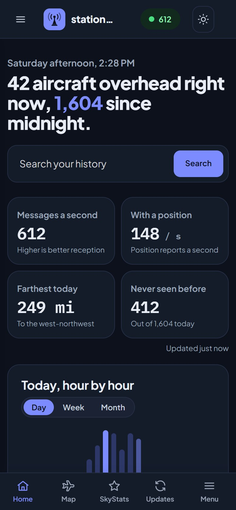
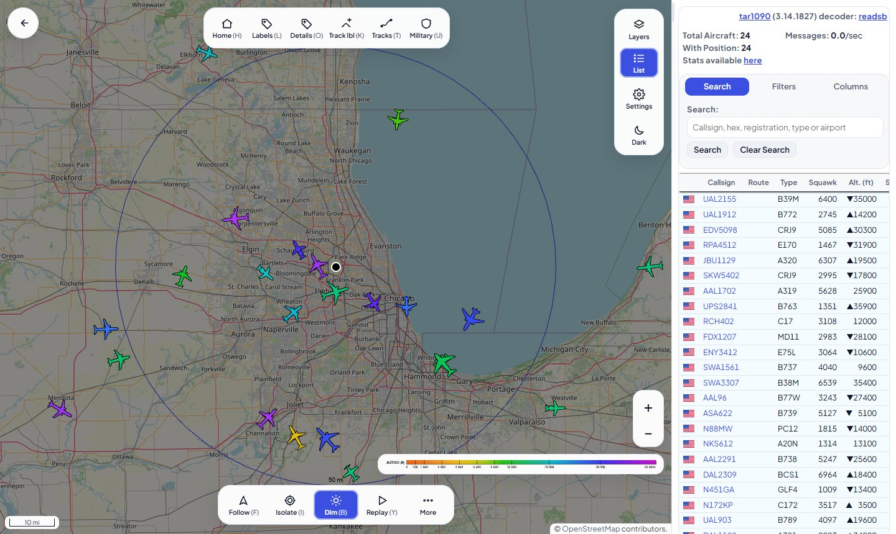
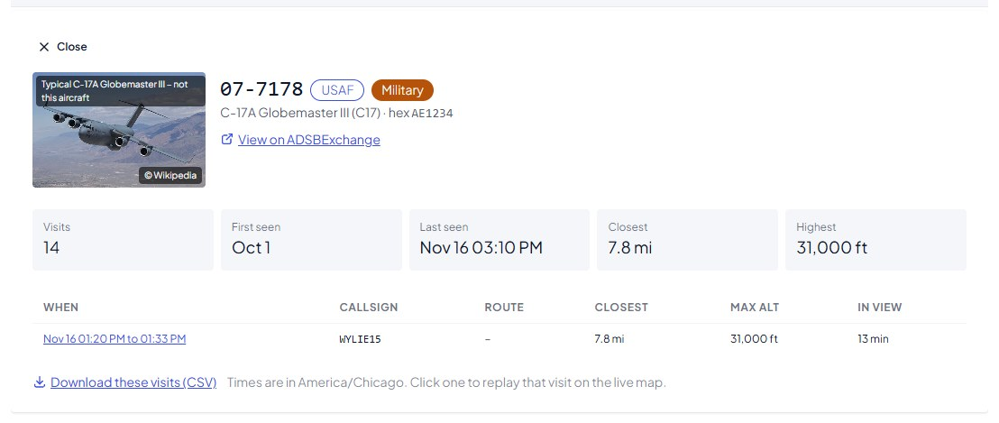
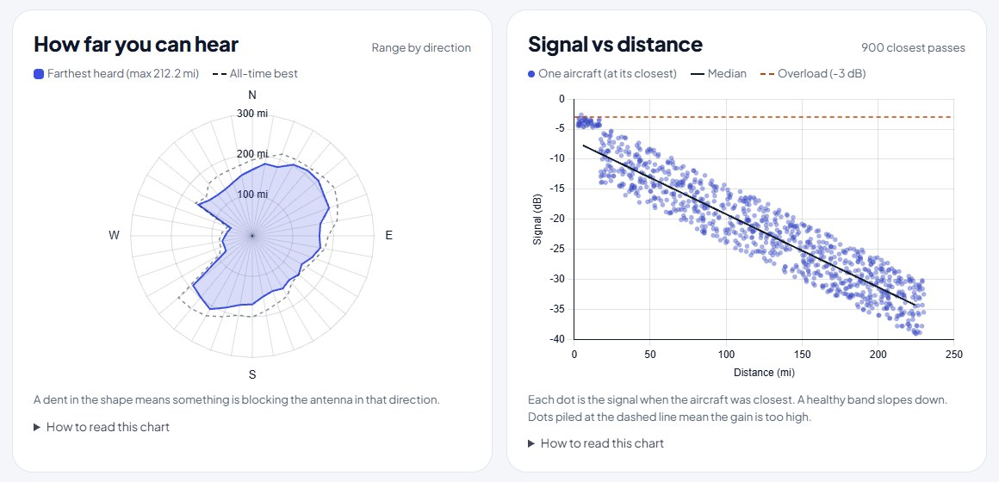
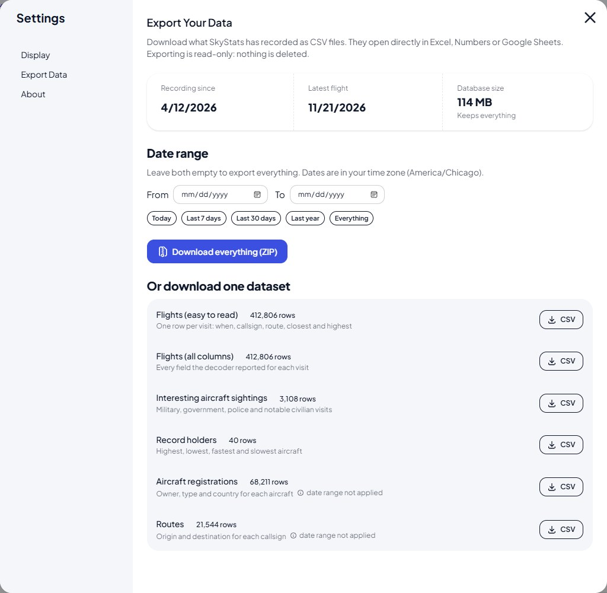

# K4NZA ADS-B Feeder

**Turn a Raspberry Pi into a plane-spotting station you can leave alone for months.**

It's Dirk Hohndel's [adsb.im feeder](https://github.com/dirkhh/adsb-feeder-image) (v3.0.15) underneath,
plus a searchable history of every aircraft you've heard, a dashboard you can read at a glance,
updates you can undo, nightly backups to a NAS, and far fewer writes to the SD card.

> [!IMPORTANT]
> **Unofficial build.** This is an independent project, not made or supported by adsb.im, Dirk Hohndel
> or the SkyStats authors. Please report problems with this build
> [here on GitHub](https://github.com/ordoleonum/adsb-feeder-k4nza-public/issues), not in the adsb.im
> or SkyStats channels.

**[Quick start](#quick-start)** · **[Tour](#a-quick-tour)** · **[Install](#install)** · **[What's new](CHANGELOG.md)** · **[SkyStats-K4NZA](https://github.com/ordoleonum/skystats-k4nza)**

Sample data.

---

## Why this build

| Feature | What it means for you |
|---|---|
| 🗂️ **Every aircraft you've ever heard** | Search your whole history by registration, callsign, type, operator or group, with photos and a replay of each visit. |
| 📊 **A dashboard, not a status page** | What you're tracking, what's closest, today's highlights with photos, new records and firsts, busy hours, and Pi health that warns you in plain English. |
| 🗺️ **A modern live map** | Light or dark, buttons with words, and replay links that follow the aircraft, on an unmodified tar1090. |
| 🔄 **Updates you can undo** | Feeder and Raspberry Pi OS updates from one page. Something wrong? **Go back** reinstalls the previous version. |
| 💾 **Nightly backup to your NAS** | Settings, graphs and your whole flight history, saved every night to a Synology or any SMB share. |
| 🔋 **Made for 24/7 on an SD card** | Logs in memory, batched database writes and lean updates, so your card lasts longer. |

## Quick start

1. **Download** the newest image from [Releases](https://github.com/ordoleonum/adsb-feeder-k4nza-public/releases/latest).
2. **Write it** to a microSD card with [Raspberry Pi Imager](https://www.raspberrypi.com/software/).
3. **Boot** the Pi with your radio plugged in, wait 5-10 minutes, and open
   **[http://adsb-feeder.local](http://adsb-feeder.local)**.
4. **Enter** your station's name and location, pick the sites to share with, and you're feeding.

Need WiFi or more detail? See the full [Install](#install) steps.

## What's new (v3.0.15-35 to -41)

- ✨ **Today's notable events:** the dashboard tells you when something happens for the first time
  ever: a new farthest distance in some direction, your busiest day, a type, an airline or a country
  you've never seen, your 5,000th different aircraft. SkyStats keeps the whole log on its Records
  tab, one line per day.
- 🏆 **Records you can trust:** Fastest, Slowest, Highest and Lowest are judged on each whole visit,
  speeds count only after they check out, and unidentified radar relays stay off the lists. Bugs
  from the original SkyStats put an airliner at 949 mph and filled Slowest with taxiing planes.
- 🕛 **One clock everywhere:** days start at the station's midnight, and SkyStats and the dashboard
  show the same "since midnight" count, whatever time zone your phone is in.
- 🔒 **Safer by default:** another website can't change the feeder through your browser, and
  shared logs no longer contain passwords or keys.
- 🗺️ **Live map:** a bigger altitude key along the bottom and a distance scale that stays put.
- 🧰 **Quieter and lighter:** background jobs can't get stuck, updates log no false errors, and a
  SkyStats panel that asked the database every 2 seconds is gone.

All the details are in the [CHANGELOG](CHANGELOG.md).

---

## A quick tour

### 📊 The dashboard

Open the feeder and it tells you what's happening in one sentence: *"Currently tracking 42 aircraft,
1,604 since midnight."*

- **Four live numbers:** messages and positions per second, the farthest aircraft today, and how many
  you'd never seen before.
- **Busy hours:** today hour by hour, or aircraft per day for the last week or month, with a
  count scale on the side.
- **Closest right now:** the four nearest aircraft with type, distance and altitude.
- **Today's highlights:** the latest military aircraft, the highest, the rarest type and the
  farthest, each with a photo. Click one to open it in SkyStats.
- **Today's notable events:** what happened for the first time ever: a new range record in some
  direction, the busiest day so far, a type, airline or country you've never seen, a round number
  of different aircraft. **Past events** opens the whole log.
- **Sharing with** and **Station health:** the sites you feed (and MLAT), CPU temperature, power
  supply, disk space and history size. Anything amber or red explains what to do.
- **Search your history** right from the top of the page.

<table>
  <tr>
    <td valign="top" width="38%"></td>
    <td valign="top"><b>Works on your phone too.</b>  
      The same dashboard in one column, with bottom tabs and a slide-in menu.  
      A <b>sun/moon switch</b> picks light or dark, and the live map and SkyStats follow your choice.  
      On a computer, a top menu (Overview, Live map, SkyStats, Graphs, Setup, System) shows your
      station name, the installed version and live receiver status.  
      Dark mode shown.</td>
  </tr>
</table>

### 🗺️ The live map

The tar1090 map you know, tidied up:

Sample aircraft, shown over Chicago.

- **Buttons with words** and their keyboard shortcut, like "Labels (L)", plus a tooltip on hover
  (press and hold on a phone).
  - Top bar: Home, Labels, Details, Track labels, Tracks, Military
  - Right column: Layers, List, Settings, light/dark
  - Bottom: Follow, Isolate, Dim, Replay and **More** (In view, Multi-select, Persist, Random, Full
    screen, Wide list)
  - Top left: **Feeder**, back to the feeder
- **The selected aircraft** on the left with its photo. A slow photo is asked for again; with no
  photo of the aircraft itself, a typical photo of its type is shown and marked as such.
- **Replay links** from SkyStats open the map at that moment with the aircraft selected, followed
  and shown on its own.
- **Search** in the aircraft list also jumps to an airport code or coordinates.
- **Routes** the route service can't confirm are checked against SkyStats instead of shown wrong.
- **Nautical, Imperial or Metric**, set under *Live map → Map options* (each browser can still
  choose its own).
- On a phone: icons only, and the map opens without the aircraft list covering it.

tar1090 itself is unmodified, so it keeps getting its own updates.

### 🔎 Your flight history, searchable

This build ships **[SkyStats-K4NZA](https://github.com/ordoleonum/skystats-k4nza)**, a modified
SkyStats with its own public repository.

**Find any aircraft** from the **Search** tab or the dashboard. Type a registration, hex code,
callsign, type (`B739`, `C17`) or operator, and see every visit:

- when it came, its callsign and route
- how close it got, how high it flew and how long it stayed in view
- a photo from planespotters.net (credited), or a marked photo of its type from Wikipedia
- an **ADSBExchange** link to see where it is now
- a **replay** of any visit on the live map, and a CSV download

Sample data. Type photo from Wikipedia.

**List a whole group.** Click **Military**, **Government**, **Police** or **Civilian** to see every
aircraft of that group you've ever heard, not just the latest few. Click any column to sort. Military
aircraft that only the feeder's own database knows about count too, with their operator and type.

Sample data.

### 📈 A report on your sky

SkyStats opens on its **Activity** report for **Today**, **Week**, **Month** or **All time**: how many
flights crossed your sky (and how that compares with the period before), different aircraft and
types, the farthest, the military ones, and when your sky is busiest, hour by hour for each day of
the week. Days and times follow your station's clock, wherever you open it from.

Sample data.

Further down: **Aircraft types**, **Who flew over most**, **Where they were going** and **Notable
visitors**, each with a photo and a **Replay** link.

The **Records** tab starts with your station's **notable events**, one line per day that opens
to show its new records, first-ever types, airlines and countries, and milestones, kept for good.
Below them are the
fastest, slowest, highest and lowest aircraft you've heard. Each visit is judged once the aircraft
has left, and a speed only counts after two readings agree with each other and with how far the
aircraft actually moved.

### 📡 How well your station hears

- **How far you can hear:** the farthest aircraft in each direction, with your all-time best as an
  outline. A dent shows where something blocks the antenna.
- **Signal vs distance:** each aircraft's signal at its closest point, with the median and the
  overload level. Use it to tune gain or check a new antenna or filter.

Sample data.

Not sure what you're looking at? **How to read this chart** under each one shows what healthy, too
much gain, too little gain and a blocked direction look like.

### 📦 Export your data

<table>
  <tr>
    <td valign="top" width="55%"></td>
    <td valign="top">Everything as a ZIP, or one dataset at a time as CSV for Excel or Google
      Sheets, with an optional date range. Open it from the gear (Settings) in SkyStats.  
      SkyStats backups can be restored under <i>System → Restore</i>.</td>
  </tr>
</table>

### 🔄 One-click updates you can undo

The **Updates** page shows what's installed, what's waiting and what's new.

- **Update feeder software** installs the newest release, including a new SkyStats when there is
  one. You see **What's new** first, and the SkyStats download shows its progress, retries if it
  stalls and is checked against a checksum. Settings and history are kept; it takes 5-15 minutes and
  feeding pauses only briefly.
- **Update Pi OS** installs Raspberry Pi OS updates, new kernels included, then cleans up. After a
  kernel update, **Restart now** appears.
- **Go back to ...** reinstalls the version you ran before (from v3.0.15-33 on).
- No account or key needed, and nothing updates on its own unless you turn on nightly OS updates
  (*System → Management*).

### 💾 Nightly backup to your NAS

Under *System → Backup → Network backup*, pick a time, and every night the feeder saves your
settings, graphs and SkyStats database to a shared folder on a NAS (a Synology or any SMB share).

Sample settings.

- Keeps as many nightly backups as you like and deletes the oldest.
- **Test connection** and **Back up now** check it straight away; the page shows how the last one
  went.
- The share is connected only while a backup runs. If the NAS is off, the feeder carries on and
  tries again an hour later.
- The NAS password sits in its own file, readable only by the system, and is never part of a
  configuration backup.
- To restore, copy a backup folder to your computer and use *System → Restore*.

### 🔋 Built to run 24/7

SD cards wear out from writes, and a feeder writes all day. This build cuts that down and keeps
running when something goes wrong.

<b>Fewer writes to the SD card</b>

- **Logs in memory:** container logs and the system log stay in RAM, as in stock adsb.im.
- **Batched history:** SkyStats saves aircraft in view at most every 30 seconds (or when a record
  changes) and reads the decoder every 5 seconds, instead of rewriting everything every 2 seconds.
- **Lighter database jobs:** small indexes, so background jobs don't scan the whole history.
- **Lean updates:** only the release being installed is downloaded, the "Go back" copy of SkyStats is
  kept compressed, and downloaded OS packages are deleted after installing.
- **Fewer background checks:** Home looks for Pi OS updates at most once a day (the Updates page
  checks every 6 hours).

<b>SkyStats that keeps going for months</b>

- Every request to the decoder and to internet services has a timeout, so one hung request can't
  freeze recording.
- Recording runs apart from the slower background jobs, and every job recovers from errors instead of
  stopping SkyStats.
- One odd value from the decoder no longer throws away the whole aircraft list.
- Memory use stays flat, and a failed plane-alert-db download is retried the next day instead of
  causing a restart loop.
- The database is tuned for a Pi and tidied weekly.
- You can limit the history (*Setup → Advanced → SkyStats → Keep history (days)*). All-time totals,
  top types and the all-time range outline stay correct anyway.

<b>Bugs fixed from the original SkyStats</b>

- **Believable speed records:** the original saved the highest speed it ever heard from an
  aircraft, so one bad reading could put an airliner on the Fastest list at 949 mph. A speed
  now counts only when two readings in a row agree, match how far the aircraft actually moved,
  come from its own ADS-B (not MLAT or TIS-B) and stay under 800 knots.
- **Records judged on the whole visit:** the original judged each aircraft for the record lists
  within 2 minutes of first seeing it and never again, so Slowest filled up with planes taxiing
  before take-off and Lowest with planes just after take-off. Records are now judged once the
  visit is over, and Slowest only counts aircraft that actually flew.
- **Background jobs that can't get stuck:** the jobs that fill the record lists and Interesting
  threw away a whole batch when one flight had an empty field, then retried that same batch
  forever. One odd row no longer stops them.
- **Airspeeds in the right columns:** indicated and true airspeed were saved in each other's
  columns in the Fastest and Slowest lists.

<b>Quiet and reachable on your network</b>

- **WiFi power saving is off**, so the Pi answers without delay spikes.
- **Other websites can't change the feeder** through your browser: changes are accepted only from
  the feeder's own pages, at whatever address you opened it. Shared logs blank out WiFi, login and
  feed passwords and keys.
- **Only the ports something uses are open:** 80 (this web interface), 8080 (map), 5173 (SkyStats),
  1089 (recovery page, for when an update goes wrong), 9999 (Dozzle, the container log viewer),
  30003 (SBS, for tools like Planefence), 30004 and 30104 (Beast in), 30005 and 30006 (Beast out),
  31005 (MLAT results). The web interface and recovery page ask for a password only if you turn on
  the login (*System → Management*); the map, SkyStats and the log viewer never do, so keep the
  feeder on a network you trust.
- **No my.adsb.im registration:** the feeder is reached at `http://adsb-feeder.local/`, and the page
  footer shows its IP address.
- **System → Share diagnostics** downloads anonymized logs and opens a problem report on this GitHub
  repository (stock adsb.im uploads them to public paste sites).

And everywhere: **plain-English help** under every settings section, tooltips on buttons, and a
confirmation before shutdown, reboot and similar actions.

---

## What you need

- **Raspberry Pi** 3, 4 or 5 (64-bit). A Pi 4 or 5 is recommended for SkyStats.
- **A good power supply:** the official one for your Pi. Cheap chargers and powered hubs are the
  most common cause of strange problems.
- **An SDR (USB radio) and a 1090 MHz antenna.** A generic RTL-SDR works. A 1090 MHz filter and an
  outdoor antenna up high make the biggest difference.
- **A microSD card** (16 GB or more, a good brand) and a computer to write it.

## Install

1. **Download** the newest `adsb-feeder-k4nza-v...img.xz` from
   [Releases](https://github.com/ordoleonum/adsb-feeder-k4nza-public/releases/latest).
2. **Write it** with [Raspberry Pi Imager](https://www.raspberrypi.com/software/): *Choose OS → Use
   custom*, pick the file, pick your card. Skip Imager's "customisation" (user, WiFi, hostname); this
   image doesn't use it.
3. **WiFi (skip if you use a network cable):** after writing, unplug and replug the card. Windows
   shows a small drive called `bootfs`. Open **`k4nza-wifi.txt`** in Notepad, fill in `SSID=`,
   `PASSWORD=` and `COUNTRY=`, save, and eject. On first boot the Pi joins that WiFi and then erases
   the password from the file.
4. **Boot the Pi** with the radio plugged in. The first start takes 5-10 minutes.
5. **Open [http://adsb-feeder.local](http://adsb-feeder.local)** in a browser on the same network (or
   the Pi's IP address from your router's device list). There is no login.
6. **Basic setup:** enter a name for your station, its latitude, longitude and height, then choose
   which sites to share your data with. Click **Submit** and give it a few minutes while everything
   starts.

> **Couldn't connect to WiFi?** If the Pi can't get online, it creates its own open WiFi called
> **`K4NZA-Feeder-Setup`**. Join it from your phone or laptop and open `http://192.168.199.1` to choose
> your home network.

The image is for Raspberry Pi (64-bit) only and has no maintainer SSH key built in.

## Everyday use

The menu at the top (or the **Menu** tab on a phone) has everything:

| Page | What it's for |
|---|---|
| **Overview** | The dashboard: what you're tracking, today's highlights, history search, station health |
| **Live map** | What you're receiving right now; Heatmap, Tracks, Replay and Map options are in its menu |
| **SkyStats** | Activity (the report), Routes, Interesting, Records (with the notable events log) and **Search**; **Export** is under its gear |
| **Graphs** | How well your station is doing over hours, days and months |
| **Setup** | Basic setup, Advanced, Radio (SDR) with a reception guide, and Data sharing |
| **System** | Updates (with **Go back**), Management, Backup and Restore (with the nightly NAS backup), logs and diagnostics |

The live map, graphs and SkyStats open in a new browser tab.

## Better reception

Most of the improvement comes from the antenna, not from settings:

- Put the antenna **as high as possible**, vertical, with a clear view of the sky. Outdoors beats
  indoors; a window beats an inner room.
- Use a short, good cable, or a USB extension to move the radio away from the Pi (the Pi's USB 3
  ports give off noise).
- A **1090 MHz SAW filter** helps a lot near phone towers and FM stations.
- Leave gain on **autogain** unless you know you need something else. **Signal vs distance** in
  SkyStats shows whether it's right.

The **Radio (SDR)** page has the full guide.

## Good to know

- **Security:** like the original, this image is meant for your home network only. Anyone who can
  open its web page can change it, so don't expose it to the internet.
- **Backups:** SD cards still wear out eventually. Turn on the nightly NAS backup, or download a
  configuration backup and a SkyStats data backup now and then (*System → Backup*).
- **SkyStats history** is kept forever by default; to limit it, set *Setup → Advanced → SkyStats →
  Keep history (days)*.
- **Updating by reflashing** also works: write a new image, then use **Restore** with a backup.

## Credits and license

- **[adsb.im ADS-B Feeder Image](https://github.com/dirkhh/adsb-feeder-image)** by Dirk Hohndel and
  contributors: the foundation of this project.
- **[SkyStats](https://github.com/tomcarman/skystats)** by Tom Carman (via
  [wiedehopf's fork](https://github.com/wiedehopf/skystats)). This feeder ships
  **[SkyStats-K4NZA](https://github.com/ordoleonum/skystats-k4nza)**, the modified build.
- **[tar1090](https://github.com/wiedehopf/tar1090)**, **readsb** and **graphs1090** by wiedehopf,
  packaged by the [SDR Enthusiasts](https://github.com/sdr-enthusiasts) containers.
- Interesting-aircraft data from the community
  [plane-alert-db](https://github.com/sdr-enthusiasts/plane-alert-db).

This project is licensed under the **GPL-3.0**, like the original (see
[LICENSE](https://github.com/ordoleonum/adsb-feeder-k4nza-public/blob/main/LICENSE)). The original
adsb.im documentation is in the [adsb.im repository](https://github.com/dirkhh/adsb-feeder-image#readme).

If this build is useful to you, you can [support it on Ko-fi](https://ko-fi.com/ordoleonum). 73, K4NZA
