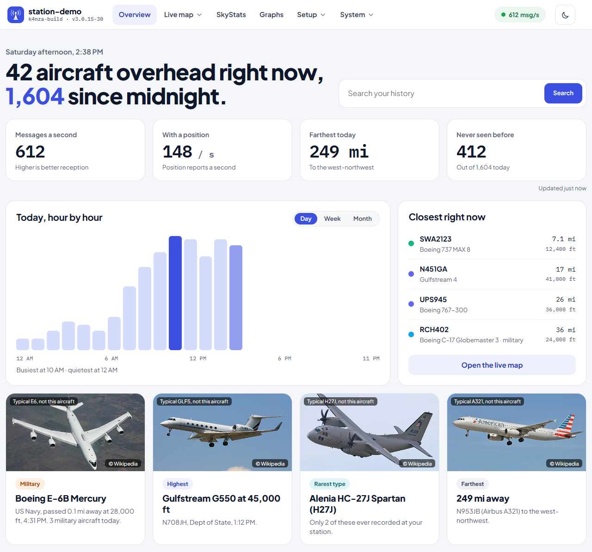
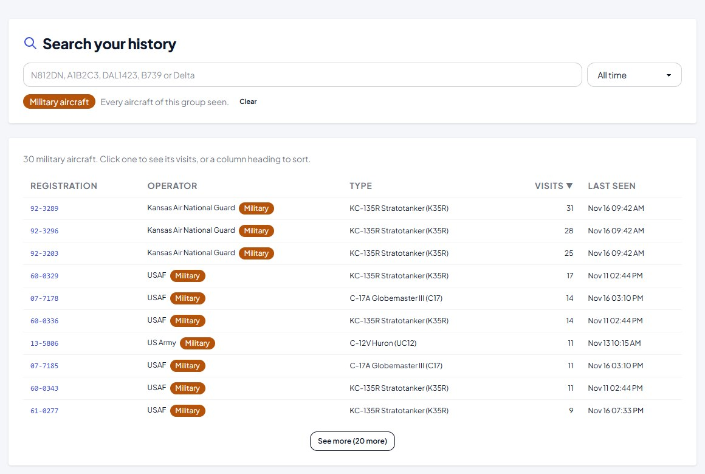
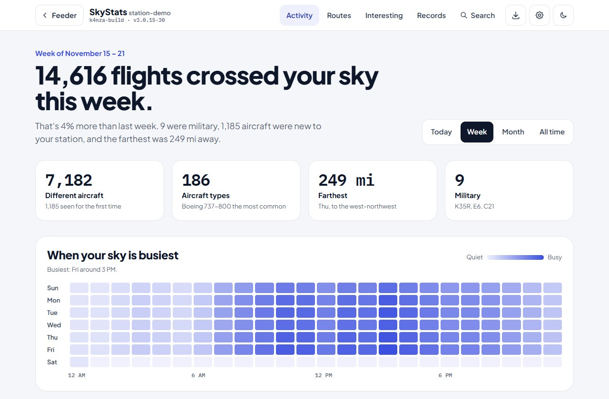
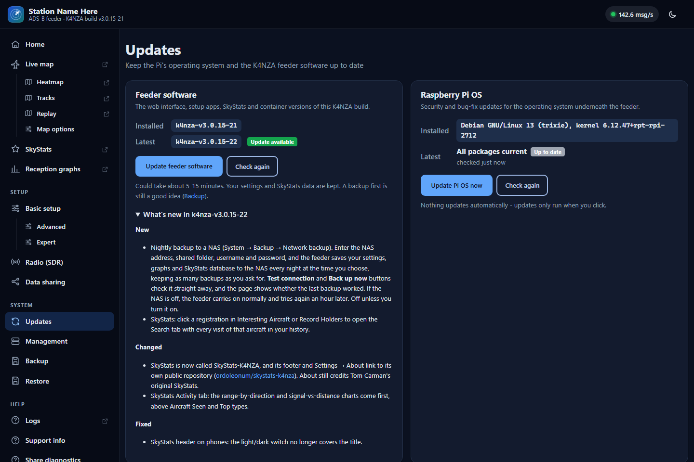
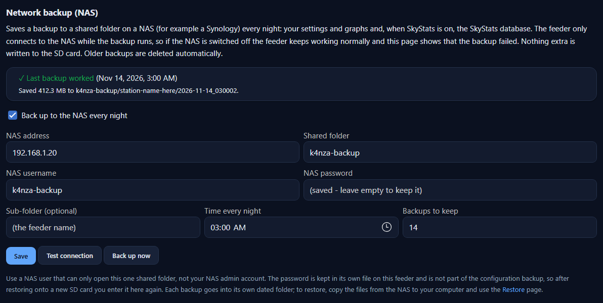

# K4NZA ADS-B Feeder

**A Raspberry Pi ADS-B feeder image built to run for months without attention.** It's Dirk Hohndel's
[adsb.im feeder](https://github.com/dirkhh/adsb-feeder-image) (v3.0.15) underneath, plus a
searchable flight history, one-click updates you can undo, nightly backups to a NAS, and far fewer
writes to the SD card.

**[Install](#install)** · **[What's new](CHANGELOG.md)** · **[SkyStats-K4NZA](https://github.com/ordoleonum/skystats-k4nza)** · **[Everyday use](#everyday-use)**

Sample data.

---

## Why this build

| Feature | What it means for you |
|---|---|
| **Runs 24/7 on an SD card** | Logs live in memory, the flight database writes in small batches, and updates clean up after themselves. Your card lasts longer. |
| **Every aircraft you've ever heard, searchable** | SkyStats-K4NZA keeps your history for months without freezing, and finds any aircraft by registration, callsign, type, operator or group. |
| **Updates in one click, and back again** | Feeder and Raspberry Pi OS updates (kernels included) from one page. If a new version misbehaves, **Go back** reinstalls the old one. |
| **Nightly backup to your NAS** | Settings, graphs and the whole SkyStats database, saved every night to a Synology or any SMB share. |
| **A dashboard, not a status page** | Aircraft overhead and today, the closest aircraft right now, today's highlights with photos, busy hours by day, week or month, and Pi health that turns amber or red with advice. |
| **A modern live map** | Light or dark, buttons with words, replay links that follow the aircraft, on an unmodified tar1090 that keeps getting its own updates. |

## New in v3.0.15-31

Fixes from a full review of -30 on a computer and a phone, in light and dark:

- **Live map photos:** a slow photo service is asked again instead of leaving "Loading image...", and
  aircraft with no photo of their own show a typical photo of their type (clearly marked).
- **Replay:** links open in your light or dark choice; on phones the aircraft panel sits above the
  replay bar.
- **Dashboard:** one count for today, Week and Month start at your first day of data, type names in
  words on photos.
- **SkyStats:** airline names no longer cut short, type names for aircraft known only by a code,
  tidier operator names.

**v3.0.15-30:** a dashboard with photo highlights and Day/Week/Month, a reorganised live map with a
Layers column and replay links that follow the aircraft, clean type names in SkyStats, and a new
antenna mark.

**v3.0.15-29:** **Daylight**, the new look across the feeder, the live map and SkyStats, in light and
dark, with the dashboard home page and the SkyStats report.

Every release is in the [CHANGELOG](CHANGELOG.md).

---

## Your flight history, searchable

This build ships **[SkyStats-K4NZA](https://github.com/ordoleonum/skystats-k4nza)**, a modified
SkyStats with its own public repository.

**Find any aircraft.** Use the **Search** tab, or the search box on the feeder's Home page. Search by
registration, hex code, callsign, type (`B739`, `C17`) or operator. You'll see every visit: when it
came, its callsign and route, how close it got, how high it flew and how long it stayed in view.
There's a photo from planespotters.net (credited to the photographer), or a photo of the type from
Wikipedia, clearly marked as not this aircraft, when there's none of the aircraft itself. An
**ADSBExchange** link shows where it is now, a click on any visit opens the live map's **replay** of
it, and you can download the visits as CSV.

Sample data. Type photo from Wikipedia.

**List a whole group.** Click **Military**, **Government**, **Police** or **Civilian** on the
Search tab or in Interesting Aircraft to see every aircraft of that group in your history, not just
the latest few. Click any column heading to sort. A registration anywhere in SkyStats opens its full
history too. Military aircraft that only the feeder's own aircraft database knows (not the
plane-alert list) count as Military, with the operator and type that database has.

Sample data.

**Built to last for months.**

- Every request to the decoder and to internet services has a timeout, so one hung request can't
  freeze recording.
- Recording runs apart from the slower background jobs, and every job recovers from errors instead
  of stopping SkyStats.
- One odd value from the decoder no longer throws away the whole aircraft list.
- Memory use stays flat, and a failed plane-alert-db download is retried the next day instead of
  causing a restart loop.
- The database is tuned for a Pi and tidied weekly.
- You can limit the history (*Setup → Advanced → SkyStats → Keep history (days)*). All-time totals,
  top types and the all-time range outline stay correct anyway.

## A report on your sky

SkyStats opens on a report for **Today**, **Week**, **Month** or **All time**: how many flights
crossed your sky compared with the period before, how many different aircraft and types, the
farthest one, the military ones, and when your sky is busiest, hour by hour for each day of the week.

Sample data.

Further down: **Aircraft types** and **Who flew over most**, **Where they were going** (the
commonest routes) and **Notable visitors** with photos and a **Replay** link for each.

## See how well your station hears

**How far you can hear** shows the farthest aircraft heard in each direction, with your all-time best
as an outline; a dent shows where something blocks the antenna. **Signal vs distance** plots each
aircraft's signal at its closest approach against distance, with the median and the overload
level, for tuning gain and checking an antenna or filter change.

Sample data.

Not sure what you're looking at? **How to read this chart**, under both charts, explains what
healthy looks like and what too much gain, too little gain, a blocked direction and gaps look like.

## One-click updates you can undo

The **Updates** page shows what's installed, what's waiting and what's new.

- **Update feeder software** installs the newest release from this repository, including a new
  SkyStats when there is one. The SkyStats download shows its progress, is retried if it stalls, and
  is checked against a checksum first. Settings and history are kept; an update takes 5-15 minutes
  and feeding pauses only briefly. **What's new** shows the release notes before you update.
- **Update Pi OS** installs Raspberry Pi OS updates, new kernels included, then removes what's no
  longer needed. After a kernel update, **Restart now** appears.
- **Go back to ...** reinstalls the version the feeder ran before, if something isn't right
  (possible from v3.0.15-20 on).
- No account or key is needed, and nothing updates on its own unless you turn on nightly OS updates
  (*System → Management*).

## Nightly backup to your NAS

Under *System → Backup → Network backup*, choose a time, and every night the feeder saves your
settings, graphs and SkyStats database to a shared folder on a NAS (a Synology or any SMB share).

- It keeps as many nightly backups as you ask for and deletes the oldest.
- **Test connection** and **Back up now** check it straight away, and the page shows how the last
  backup went.
- The share is connected only while a backup runs. If the NAS is off, the feeder carries on and
  tries again an hour later. Nothing extra is written to the SD card.
- The NAS password sits in its own file, readable only by the system, and is never part of a
  configuration backup.
- To restore, copy a backup folder to your computer and use *System → Restore*.

Sample settings.

## Built to run 24/7

SD cards wear out from writes, and a feeder writes all day. This build cuts that down:

- **Logs in memory:** container logs and the system log stay in RAM, as in stock adsb.im.
- **Batched history:** SkyStats saves aircraft in view at most every 30 seconds (or when a record
  changes) and reads the decoder every 5 seconds, instead of rewriting everything every 2 seconds.
- **Lighter database jobs:** small indexes, so background jobs don't scan the whole flight history.
- **Lean updates:** only the release being installed is downloaded, the "Go back" copy of SkyStats
  is kept compressed, and downloaded OS packages are deleted after installing.
- **Fewer background checks:** Home looks for Pi OS updates at most once a day (the Updates page
  checks every 6 hours).

It also stays reachable and quiet on your network:

- **WiFi power saving is off**, so the Pi answers without delay spikes.
- **Only the ports something uses are open:**
  - 8080 for the map
  - 30003 for SBS, used by tools like Planefence
  - 30004 and 30104 for Beast in
  - 30005 and 30006 for Beast out
  - 31005 for MLAT results
- **No my.adsb.im registration:** the feeder is reached at `http://adsb-feeder.local/`, and the page
  footer shows its IP address.

## A dashboard you can read at a glance

- **A top menu** on a computer (Overview, Live map, SkyStats, Graphs, Setup, System) with your
  station name, the installed version and live receiver status; a slide-in menu and bottom tabs on a
  phone. Light and dark, with a sun/moon switch that the live map and SkyStats follow.
- **Overview** says it in one sentence ("42 aircraft overhead right now, 1,604 since midnight"), with
  a search box for your history. Four numbers follow: messages and positions per second (every 5
  seconds), the farthest aircraft today and how many were never seen before.
- **Busy hours:** today hour by hour, or aircraft per day for the last week or month, with the busiest
  and quietest hour or day.
- **Closest right now:** the four nearest aircraft with type, distance and altitude.
- **Today's highlights:** the latest military aircraft, the highest, the rarest type and the farthest,
  each with a photo; click one to open it in SkyStats.
- **Sharing with** shows each site you feed and whether MLAT is on; **Station health** covers CPU
  temperature, power supply, free disk space and SkyStats history size. Each turns amber or red; tap
  or hover over it for advice.
- **Plain-English help** under every settings section, tooltips on buttons, and a confirmation
  before shutdown, reboot and similar actions. The **Radio (SDR)** page has a step-by-step guide to
  better reception.
- **System → Share diagnostics** downloads anonymized logs and opens a problem report on this GitHub
  repository. Stock adsb.im uploads them to public paste sites instead.

<table>
  <tr>
    <td valign="top" width="40%"><b>On a phone</b>: the same dashboard in one column, bottom tabs and a slide-in menu (dark mode shown).  
      </td>
    <td valign="top" width="60%"><b>SkyStats export</b>: everything as a ZIP, or one dataset at a time as CSV for Excel or Google Sheets, with an optional date range. SkyStats backups can be restored under <i>System → Restore</i>.  
      </td>
  </tr>
</table>

- Light or dark panels for the buttons, aircraft list, selected aircraft, settings and legend, in the
  same look as the feeder.
- Icon-and-word buttons instead of single letters, each with its keyboard shortcut, like
  "Labels (L)", and a tooltip on hover (press and hold on a phone):
  - top bar: Home, Labels, Details, Track labels, Tracks and Military
  - right column: Layers, List, Settings and light/dark
  - bottom: Follow, Isolate, Dim, Replay and **More** (In view, Multi-select, Persist, Random, Full
    screen, Wide list)
  - top left: **Feeder**, back to the feeder.
- The selected aircraft on the left with its photo (asked for again if it doesn't arrive).
- The search box in the aircraft list also jumps to an airport code or coordinates.
- **Replay** links from SkyStats open the map at that moment with the aircraft selected, followed and
  shown on its own; the buttons move up above the replay controls.
- Routes the route service can't confirm are checked against SkyStats instead of shown wrong.
- On a phone: icons only, and the map opens without the aircraft list covering it.
- **Nautical, Imperial or Metric** for distances, speeds and altitudes in the map and SkyStats. Set
  the default under *Live map → Map options*; each browser can still switch on its own.
- tar1090 itself is unmodified, so it keeps getting its own updates.

Sample aircraft, shown over Chicago.

---

## What you need

- **Raspberry Pi** 3, 4 or 5 (64-bit). A Pi 4 or 5 is recommended if you use SkyStats.
- **A good power supply**: the official one for your Pi. Cheap chargers and powered hubs are the most
  common cause of strange problems.
- **An SDR (USB radio) and an antenna for 1090 MHz.** A generic RTL-SDR works. A 1090 MHz filter and
  an outdoor antenna up high make the biggest difference.
- **A microSD card** (16 GB or more, a good brand) and a computer to write it.

## Install

1. **Download** the newest `adsb-feeder-k4nza-v...img.xz` from
   [Releases](https://github.com/ordoleonum/adsb-feeder-k4nza-public/releases/latest).
2. **Write it** with [Raspberry Pi Imager](https://www.raspberrypi.com/software/): *Choose OS → Use
   custom*, pick the file, pick your card. Skip Imager's "customisation" (user, WiFi, hostname),
   because this image doesn't use it.
3. **WiFi (skip if you use a network cable):** after writing, unplug and replug the card. Windows
   shows a small drive called `bootfs`. Open **`k4nza-wifi.txt`** in Notepad, fill in `SSID=` and
   `PASSWORD=` (and `COUNTRY=`), save, and eject. On first boot the Pi joins that WiFi and then erases
   the password from the file.
4. **Boot the Pi** with the radio plugged in. The first start takes 5-10 minutes.
5. **Open [http://adsb-feeder.local](http://adsb-feeder.local)** in a browser on the same network (or
   the Pi's IP address from your router's device list). There is no login.
6. **Basic setup:** enter a name for your station, its latitude, longitude and height, then choose
   which sites to share your data with. Click Submit and give it a few minutes while everything
   starts.

**Couldn't connect to WiFi?** If the Pi can't get online, it creates its own open WiFi called
**`adsb.im-feeder`**. Join it from your phone or laptop and open `http://192.168.199.1` to choose
your home network.

The image is for Raspberry Pi (64-bit) only and has no maintainer SSH key built in.

## Everyday use

The menu at the top (or the **Menu** tab on a phone) has everything:

| Page | What it's for |
|---|---|
| **Overview** | The dashboard: what's overhead, today's highlights, history search, station health |
| **Live map** | The aircraft you're receiving right now; Heatmap, Tracks, Replay and Map options are in its menu |
| **SkyStats** | The report, routes, interesting aircraft, records, **Search** and **Export** |
| **Graphs** | How well your station is doing over hours, days and months |
| **Setup** | Basic setup, Advanced, Radio (SDR) with a reception guide, and Data sharing (which sites get your data) |
| **System** | Updates (with **Go back**), Management, Backup and Restore (with the nightly NAS backup), logs and diagnostics |

The live map, graphs and SkyStats open in a new browser tab.

## Better reception

Most of the improvement comes from the antenna, not from settings:

- Put the antenna **as high as possible**, vertical, with a clear view of the sky. Outdoors beats
  indoors; a window beats an inner room.
- Use a short, good cable, or a USB extension to move the radio away from the Pi (the Pi's USB 3
  ports give off noise).
- A **1090 MHz SAW filter** helps a lot near phone towers and FM stations.
- Leave gain on **autogain** unless you know you need something else. **Signal vs Distance** in
  SkyStats shows whether it's right.

The **Radio (SDR)** page has the full guide.

## Good to know

- **Security:** like the original, this image is meant for your home network only. Anyone who can
  open its web page can change it, so don't expose it to the internet.
- **Backups:** SD cards still wear out eventually. Turn on the nightly NAS backup, or download a
  configuration backup and a SkyStats data backup now and then (*System → Backup*).
- **SkyStats history** is kept forever by default. To limit it, set *Setup → Advanced → SkyStats →
  Keep history (days)*.
- **Updating by reflashing** also works: write a new image, then use **Restore** with a backup.

## Credits and license

- **[adsb.im ADS-B Feeder Image](https://github.com/dirkhh/adsb-feeder-image)** by Dirk Hohndel and
  contributors: the foundation of this project.
- **[SkyStats](https://github.com/tomcarman/skystats)** by Tom Carman (via
  [wiedehopf's fork](https://github.com/wiedehopf/skystats)). This feeder ships
  **[SkyStats-K4NZA](https://github.com/ordoleonum/skystats-k4nza)**, the modified build.
- **[tar1090](https://github.com/wiedehopf/tar1090)**, **readsb** and **graphs1090** by wiedehopf,
  packaged by the [SDR Enthusiasts](https://github.com/sdr-enthusiasts) containers.
- Interesting-aircraft data from the community
  [plane-alert-db](https://github.com/sdr-enthusiasts/plane-alert-db).

This project is licensed under the **GPL-3.0**, like the original (see
[LICENSE](https://github.com/ordoleonum/adsb-feeder-k4nza-public/blob/main/LICENSE)). The original
adsb.im documentation is in the [adsb.im repository](https://github.com/dirkhh/adsb-feeder-image#readme).

If this build is useful to you, you can [support it on Ko-fi](https://ko-fi.com/ordoleonum). 73, K4NZA
